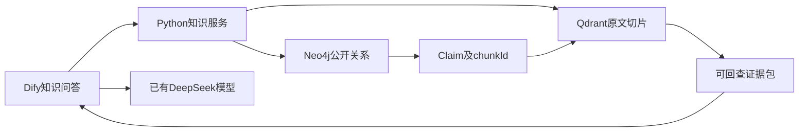

# 第四阶段：Neo4j 与 GraphRAG

2026-11-08。本机已建公开论文概念图，接入已有Python/Qdrant及独立Dify演示；原MES助手和业务流程保持现状。维护业务图只用标明synthetic的示例验证，尚未同步真实MES订单。

## 你现在可以使用

- [Dify第四阶段工作流](http://127.0.0.1:18080/app/7d20a448-fd0f-46ca-b062-b988fde2bfbc/workflow)：输入question，history可空。可问“Mura与分段伽马校正、APSO是什么关系？请给出处”。
- [Neo4j Browser](http://127.0.0.1:17474)：连接 `bolt://127.0.0.1:17687`，用户 `neo4j`，密码取本地 `.env.neo4j.local` 的 `MES_GRAPH_PASSWORD`。不要把密码发到聊天。
- [可视化查询](../rag/graph-visualization.cypher) 开头给出了读取本机活动发布版本的 PowerShell 命令。在 Browser 设置参数后，可先核对各类节点数量，再查看文档与全部切片、研究关系及其证据。

模型与知识服务密钥已从第三阶段复制到独立应用，不用重新购买/配置API。旧第三阶段vector应用保留。第四阶段应用暂未接Java入口，也不需要你现在创建新的应用API Key。

## 实际结构



公开图：3 Document、125 Chunk、11 Entity（缺陷/方法）、8 Claim、10 SUPPORTED_BY链接。另有明确隔离的business_demo域，包含5节点4关系的模拟订单→订单行→计划→工单→检验示例。示例不是来自实际MES。

本次不是“只把图画出来”：Neo4j路径会补入Qdrant未命中的原文证据，进入Dify回答。模型不生成Cypher。出处、版本、撤回和根路径连通性均由代码检查。上下文最多5块时可能截断，输出显式记录覆盖限制。

## 服务与日常启动

采用Neo4j Community **5.26.32**、Python driver6.4.0。虽然5.26.33已有发布说明，本次官方Docker镜像尚无该tag，因此固定官方可用的5.26.32-community，记录镜像digest而不使用浮动latest：[官方镜像清单](https://github.com/docker-library/official-images/blob/master/library/neo4j)。内存上限1.5GiB，heap最大512MiB/pagecache128MiB，CPU上限2；本机实测运行约633MiB，非性能容量承诺。

独立Compose项目 `mes-graph-local`，数据卷 `mes-graph-local_mes_knowledge_neo4j`、日志卷 `mes-graph-local_mes_knowledge_neo4j_logs`。仅本机17474/17687，未复用MES数据库/端口。私有配置 `.env.neo4j.local` 已被Git忽略，MES_GRAPH_ENABLED=true只启用Python图能力，不打开Java助手。

Docker Desktop运行后，在项目根目录：

```powershell
& .\backend\assistant\deploy\Start-GraphLocal.ps1
& .\backend\assistant\deploy\Start-KnowledgeLocal.ps1
```

Start-GraphLocal验证Neo4j数据库为只读才完成。Python已运行时Start-KnowledgeLocal保留进程；修改Python代码/图配置后需仅重启知识进程，不重启MES。当前没有安装开机自启动。

Neo4j Community没有本次所需的企业级细粒度reader权限；采用数据库只读配置、固定模板和本机端口，维护管理员凭据受信保管。读取模式标志本身不等于访问控制，[官方Driver文档](https://neo4j.com/docs/python-manual/current/transactions/)也作此区分。不要将本机配置直接作为工厂多租户部署方案。

## 重新构建与恢复

```powershell
# 仅在图声明或Qdrant版本变化后重建，不需要每次启动重建
& .\backend\assistant\deploy\Update-GraphLocal.ps1 -Kind Public
```

脚本持有整个维护窗口的跨进程锁，临时让独立Neo4j可写，校验后发布新generation，最后恢复并验证只读。维护期间图查询明确降级，vector仍可用；不要同时手动切Docker模式或绕过维护锁。失败原件与旧generation保留；若系统崩溃打断finally，运行Start-GraphLocal恢复只读。图API会拒绝使用可写状态的图。

只读验证：

```powershell
$env:PYTHONPATH = (Resolve-Path backend/assistant/rag/src).Path
$env:PYTHONIOENCODING = 'utf-8'
& backend/assistant/rag/.venv/Scripts/python.exe backend/assistant/rag/scripts/evaluate_graph.py --output docs/ai-planning-2026-11-07/verification/stage4-graph-live.json
& backend/assistant/rag/.venv/Scripts/python.exe -m mes_knowledge.cli graph-trace DEF_MURA
```

评测包括回滚的拒写探针；若只读配置错误，探针也不会持久化。不是独立准确率基准。requirements.lock.txt已更新，仅安装于现有RAG专用venv。

停止图：`docker compose --project-name mes-graph-local --env-file backend/assistant/deploy/.env.neo4j.local -f backend/assistant/deploy/neo4j.compose.yml stop`。不要down -v。备份Neo4j卷时先停止这个独立容器，取得一致的离线卷备份，再启动；同时保存私有配置、graph-active.json、graph-releases、business-graphs/business-releases、声明清单、Qdrant与原件目录。数据库卷、向量release和元数据指针必须匹配；恢复后先验证，再开放图模式。

## 业务图目前到哪一步

Java新增独立、默认关闭的维护导出：`POST /ai-internal/knowledge-export/order-chain`。固定SELECT，独立维护key和订单主键白名单，精确FK关联，不凭物料名猜批次。详见[实际导出契约](../contracts/stage4-graph-export.md)。没有改旧Controller/Service或业务表。

当前只导入这个明确模拟的示例：

```powershell
& .\backend\assistant\deploy\Update-GraphLocal.ps1 -Kind Business -ExportFile backend/assistant/rag/tests/fixtures/business-order-demo.json -ExpectedOrder 900001 -Synthetic
```

原始示例与说明在rag/tests/fixtures。重复相同包不会创建新快照；更新使用新generation，旧边不进入当前结果；失败/截断的新包不能把旧快照继续标为READY。维护CLI可用 `python -m mes_knowledge.cli business-trace --order 900001` 查看，公共HTTP和Dify不提供这个工具。

未来真实同步需要单独配置 `assistant.v2.graph-export.enabled=true`、独立 `bearer-key` 和明确 `allowed-order-ids`，并通过真实Java/MySQL事务与权限验收。不要将Dify key作为维护凭据，不要默认导出所有订单。该开关独立于assistant.v2.enabled，不要求切换旧助手。本次未启用或重启MES，因此这些真实同步配置尚未填写。

项目知识卡仍为DRAFT；设备、售后、实际物料批次、私有知识权限和七Agent scope调用留在后续。没有因为加入图谱就获得精确可发货数量或交期承诺。
