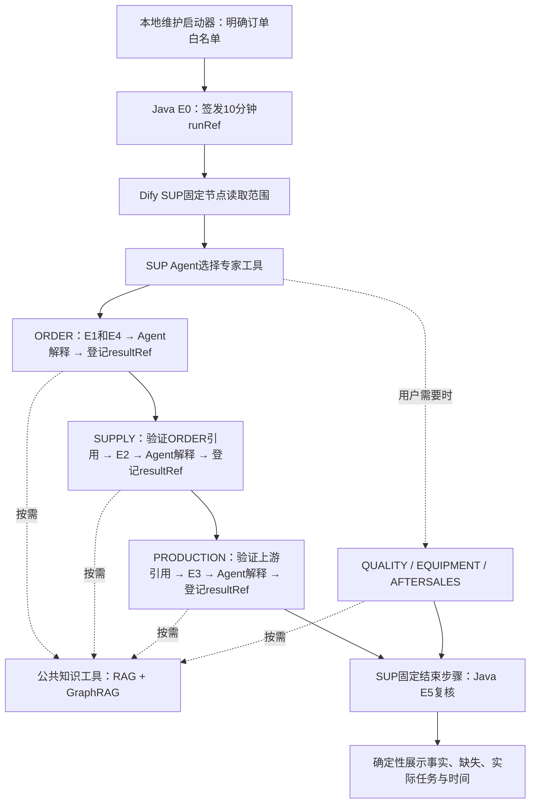

# 第五阶段：七个Agent与订单交付只读预览

2026-11-08。七个角色已建立独立Dify应用，均包含真实FunctionCalling Agent节点；另有一个共享知识工具应用，不计入业务Agent数量。MES原助手入口仍保持原状。

当前验收状态（2026-11-09更新）：**订单主键101的真实只读交付链已跑通**，总协调完成三个核心专家调用及E5复核；第二次扩展运行完成全部六专家调用，QUALITY实际调用共享RAG/GraphRAG，返回graph_assisted与MATCHES。最终均为INSUFFICIENT_EVIDENCE，不是确认订单能按期交付。MES入口仍未切换。

继续补齐后：Q1/D1/A1已接真实业务查询，并增加八种订单范围场景。当前版本的字段、计算口径和限制见[真实业务证据契约](../contracts/stage6-business-evidence.md)。下表和启动方法已同步更新。

## 实际应用

| 角色 | 本机Dify入口 | 固定业务事实 | Agent可用工具 |
|---|---|---|---|
| SUP 总协调 | [工作流](http://127.0.0.1:18080/app/82cda4ca-f087-48c6-9f1b-f8004e55fd4d/workflow) | 已授权运行范围、最终E5复核 | 六个专家Workflow工具 |
| ORDER 订单计划 | [工作流](http://127.0.0.1:18080/app/b9f177c3-e232-4367-9401-36f7e237fdff/workflow) | E1订单/计划、E4履约 | 共享公开知识工具 |
| SUPPLY 采购库存 | [工作流](http://127.0.0.1:18080/app/1cd78b75-ed86-4589-bf38-75b337104a15/workflow) | E2材料事实，依赖ORDER结果 | 共享公开知识工具 |
| PRODUCTION 生产调度 | [工作流](http://127.0.0.1:18080/app/90aceeba-bed6-434a-9945-931bb809721a/workflow) | E3生产执行，依赖ORDER/SUPPLY结果 | 共享公开知识工具 |
| QUALITY 质量检测 | [工作流](http://127.0.0.1:18080/app/728429ed-ad64-43fc-8433-018b74a66725/workflow) | Q1检验、检验项、不合格记录 | 共享公开知识工具 |
| EQUIPMENT 设备保障 | [工作流](http://127.0.0.1:18080/app/a86a9204-d860-4116-b258-3fda12f92566/workflow) | D1设备关联、报警与维修 | 共享公开知识工具 |
| AFTERSALES 售后追溯 | [工作流](http://127.0.0.1:18080/app/850e0f0d-3e72-4dbd-b23d-dd64319ef155/workflow) | A1案件/任务/处置、实际生产追溯路径 | 共享公开知识工具 |

共享知识工具应用：`6224d5ee-bd56-4ad3-a77e-a0f5eea1e447`，工具名`public_display_knowledge`。复用第四阶段Python18081、Qdrant和Neo4j；只检索公开论文，不访问维护业务图。原第二、三、四阶段Dify应用保留。

## 订单交付流程



图中的调用者是Dify SUP Agent。Java只约束已授权范围、允许的角色和业务数据依赖，没有在Java写模型推理或自由调度流程。子Agent不互相调用，只把结果交回SUP；模型不能填写runRef、凭据、业务数量或queryRef来替代服务端证据。

每个专家有9个处理节点：输入→输入校验→固定业务HTTP→任务校验→Agent→评论包装→固定结果登记HTTP→引用校验→输出。总协调有8个处理节点，包含一个Agent；不是把七个处理节点称为七个Agent。

当前所有E接口仍是PARTIAL。剩余交付沿用E4记录口径；增加严格核对质检/批次/入库/库存的候选分配情景和当前BOM材料情景，但不捏造订单预留或冻结需求。交付场景仍为INSUFFICIENT_EVIDENCE、DATA_CHANGED或INCOMPLETE；独立领域查询完成可为EVIDENCE_READY，含义仅为查询完成。

## 目前需要配置什么

不需要新的DeepSeek key、不需要租GPU。官方[Agent策略插件](https://marketplace.dify.ai/plugin/langgenius/agent)0.0.51已安装；使用FunctionCalling与现有deepseek-flash。七个独立运行密钥已在本地生成，按角色分别绑定Dify秘密变量ROLE_API_KEY；引导创建运行的BOOTSTRAP key不会交给Dify。

新电脑使用仓库根目录的新机配置入口。在已有、已完成业务迁移的 MES 数据库上，也可以从项目根目录单独运行以下初始化步骤。准备好本机 MySQL 的建账号及授权权限、明确授权的维护预览订单主键，以及日常聊天使用的千问 API 密钥。脚本生成独立的工作流角色密钥，创建订单草稿表，并核对四个只读账号。新配置中的 MySQL 管理员密码仅供本次初始化使用。

```powershell
& .\backend\assistant\rag\.venv\Scripts\python.exe .\backend\assistant\deploy\Initialize-MesAssistant.py
& .\backend\assistant\rag\.venv\Scripts\python.exe .\backend\assistant\deploy\Prepare-AssistantReadersLocal.py --verify-only
```

脚本为 Agent 业务查询、工作台身份校验、订单图谱导出和历史经验检索分别创建限本机 TCP 使用的 SELECT 账号，凭据保存为本目录的 `.env.agent-read.local`、`.env.workbench-read.local`、`.env.trace-read.local` 和 `.env.history-read.local`。各启动器按用途加载，缺少文件时请先运行初始化命令。重复运行会核对现有权限，`--verify-only` 直接以四个查询账号验证授权、角色及限定表投影。工作台的订单草稿操作仍走 MES 接口。已有本机安装可先准备账号，在下次正常启动时加载新凭据。

Java 读连接超时为 5 秒、套接字超时为 20 秒，默认查询超时为 15 秒。Python 历史读取使用只读一致性快照，连接超时为 3 秒、读取超时为 12 秒，单条 SELECT 的服务端预算为 8 秒。维修及不合格品经验账号只读取事实投影涉及的 9 张表的指定列。

`MES_AGENT_ALLOWED_ORDER_IDS`必须是明确的订单数字主键，例如`10,11`，不能填订单编号或`*`。本次已核对并加入订单100和101，不默认开放全部订单。配置模板见[.env.agents.local.example](.env.agents.local.example)。

## 启动和使用

数据库配置与订单白名单就绪后，从项目根目录运行：

```powershell
& .\backend\assistant\deploy\Start-GraphLocal.ps1
& .\backend\assistant\deploy\Start-KnowledgeLocal.ps1
& .\backend\assistant\deploy\Start-AgentRuntimeLocal.ps1 -Build
# 本机已核对并列入白名单的真实订单主键为101。
& .\backend\assistant\deploy\New-AgentPreviewRun.ps1 -OrderPk 101
# 六专家综合分析（100有已登记质检及设备关联）
& .\backend\assistant\deploy\New-AgentPreviewRun.ps1 -OrderPk 100 -Profile FULL_ASSESSMENT
# 只查询质量，不强行调用交付三个专家
& .\backend\assistant\deploy\New-AgentPreviewRun.ps1 -OrderPk 100 -Profile QUALITY
```

Start-AgentRuntimeLocal只启动独立`Stage5RuntimeMain`，本机18082；没有Spring全量启动、业务定时器或旧Service扫描。不执行backend/restart-backend.ps1。端口被占用时不会杀死原进程。Java最大堆384MiB，密码通过子进程环境提供，不出现在命令参数中。

New-AgentPreviewRun打印短期run_ref。打开上表SUP工作流，在运行输入中填`run_ref`和`query`，例如“请判断这张订单当前的交付准备情况，分别说明已知事实和缺失证据”。run_ref过期、进程重启或数据变化时重新创建；不能把旧的缓存评估当作实时查询。无需为此预览新增Dify应用API Key。

本版本固定知识工具按需调用。比如要求“结合公开资料说明Mura检测方法”，QUALITY先解释Q1真实检验记录，再从论文图谱取证；资料不会变成该订单的质量结论。无检验记录时返回已查无记录，而非宣称接口未实现。

## 修改与迁移

- 正式提示词在`agents/prompts/stage5`；Code节点源在`agents/scripts/stage5_nodes.py`；生成器`build_stage5.py`将同一份已测试函数嵌入DSL。不能只在Dify界面改一份后遗忘本地版本。
- 实际本机应用/工具ID见`agents/bindings.stage5.local.json`；不含密钥。catalog仍不作为用户授权来源，MES enabled继续false。
- 新环境需要安装相同插件和模型供应商，先导入共享知识工具，再导入六专家并发布成工具，最后重新绑定SUP的六个工具ID；更新绑定文件后重新生成DSL。不能直接复用旧环境的工具UUID。
- `Manage-Stage5Dify.py`是本机部署管理脚本，仅操作绑定清单中名称准确匹配“（第五阶段）”的应用，调用已安装Dify的管理服务完成秘密变量、草稿、发布、工具登记和测试。它不修改Dify账户密码/登录会话、不管理其他应用、不接MES数据库。密钥通过stdin传入容器，DSL导出保留空值。
- 实际Java运行接口见[stage5-runtime契约](../contracts/stage5-runtime.md)。公开GraphRAG沿用[第四阶段契约](../contracts/stage4-graph-knowledge.md)。

## 当前边界

这是可信本机管理员的只读预览，不是面向客户/车间所有用户的生产授权服务。运行凭据按专家区分；用户身份、部门字段投影、多租户、持久化跨实例运行和前端切换尚未接入。后续接MES入口必须将每次run绑定真实登录用户权限，不能把本地维护凭据作为普通用户凭据。

当前数据库账户不宣称只有SELECT授权；运行服务通过固定SELECT注册、显式只读事务、回滚及窄接口限制行为。真实投产应单独提供只读账户，不能把本机预览配置直接公开到网络。

六领域的订单范围只读查询已经接入；数据库仍没有订单预留明细、冻结工单BOM、可关联质检单的历史YOLO原始结果，故对应确认字段仍未知。售后业务路径来自实时SQL核验，公开论文GraphRAG来自Neo4j，两者来源标注分开。原助手及原业务流程继续运行。
